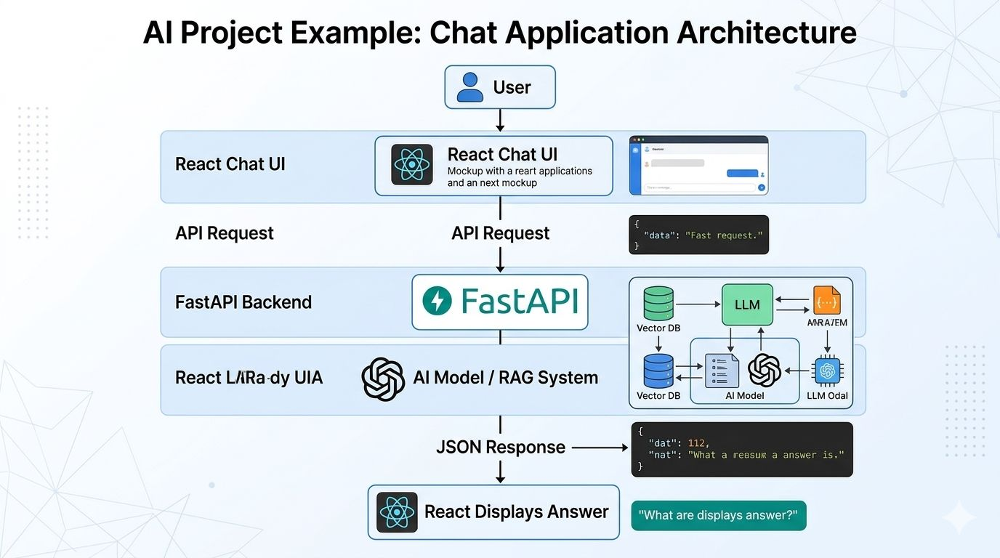
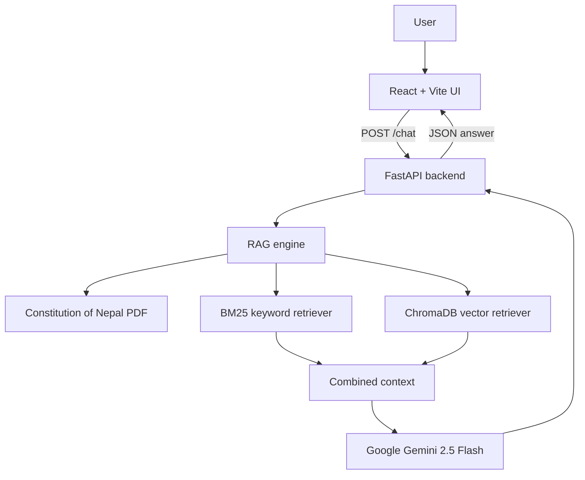

# Nepal Constitution Chatbot



A Retrieval-Augmented Generation (RAG) chatbot that answers questions about the **Constitution of Nepal, 2015**. The application combines a React chat interface, a FastAPI service, local semantic embeddings, keyword search, ChromaDB, and Google Gemini.

> This project is an educational reference tool. It does not provide legal advice. Verify important information against the official constitutional text.

## Features

- Answers questions using the supplied Constitution of Nepal PDF.
- Combines semantic vector search with BM25 keyword search.
- Uses local `all-MiniLM-L6-v2` embeddings, so document embeddings do not require an embedding API.
- Uses Gemini 2.5 Flash to synthesize answers from retrieved passages.
- Provides a React and Vite chat interface with Markdown response rendering.
- Persists the vector index in `backend/chroma_db` for reuse between runs.

## Architecture



### Retrieval pipeline

1. `PyPDFLoader` loads the constitutional document.
2. `RecursiveCharacterTextSplitter` creates chunks of 1,000 characters with 150 characters of overlap.
3. Hugging Face embeddings index the chunks in ChromaDB.
4. BM25 finds exact legal terms, article numbers, and phrases.
5. An ensemble retriever combines BM25 (30%) and vector search (70%).
6. Gemini generates an answer using only the retrieved context.

The RAG chain is initialized lazily on the first chat request. The first request may therefore take longer while the PDF is loaded and embeddings are prepared.

## Requirements

- Python 3.10 or newer
- Node.js 18 or newer and npm
- A Google Gemini API key
- Enough disk space for the embedding model and ChromaDB index

## Installation

### 1. Configure the backend

From the repository root:

```powershell
cd backend
python -m venv .venv
.venv\Scripts\Activate.ps1
pip install -r requirements.txt
```

Create `backend/.env`:

```env
GOOGLE_API_KEY=your_gemini_api_key
```

Keep this file private and do not commit it.

### 2. Start the API

With the virtual environment activated and the current directory set to `backend`:

```powershell
uvicorn main:app --reload --port 8000
```

The API is available at `http://localhost:8000`. Interactive API documentation is available at `http://localhost:8000/docs`.

### 3. Start the frontend

Open a second terminal from the repository root:

```powershell
cd frontend
npm install
npm run dev
```

Open the URL printed by Vite, normally `http://localhost:5173`.

## API

### Health check

```http
GET /
```

Example response:

```json
{
  "status": "ok",
  "service": "Nepal Constitution Chatbot API"
}
```

### Ask a question

```http
POST /chat
Content-Type: application/json
```

Request:

```json
{
  "message": "What are the fundamental rights?"
}
```

Response:

```json
{
  "answer": "..."
}
```

## Project structure

```text
constitution-chatbot/
├── backend/
│   ├── chroma_db/                  # Persisted vector index
│   ├── consituition of nepal.pdf   # Source document used by the RAG engine
│   ├── main.py                     # FastAPI application and API routes
│   ├── rag_engine.py               # Loading, retrieval, and generation pipeline
│   └── requirements.txt            # Python dependencies
├── frontend/
│   ├── public/                     # UI images and static assets
│   ├── src/components/             # Header, chat box, and message components
│   ├── src/App.jsx                 # Main application layout
│   └── package.json                # Frontend scripts and dependencies
└── README.md
```

## Frontend commands

Run these from `frontend`:

```bash
npm run dev       # Start the development server
npm run build     # Create a production build
npm run lint      # Run ESLint
npm run preview   # Preview the production build locally
```

## Troubleshooting

- **`GOOGLE_API_KEY is missing`**: create `backend/.env` and restart the API.
- **The first request is slow**: the embedding model and vector index may be loading for the first time.
- **The frontend cannot reach the API**: make sure the backend is running on port 8000 and that the frontend origin is one of the CORS origins configured in `backend/main.py`.
- **The source PDF is not found**: keep `consituition of nepal.pdf` in the `backend` directory. The filename currently matches the existing project file, including its spelling.

## License and source text

Add the appropriate license for your own code before publishing this project. Check the applicable rights and attribution requirements for any Constitution of Nepal source document and third-party images included in a deployment.
